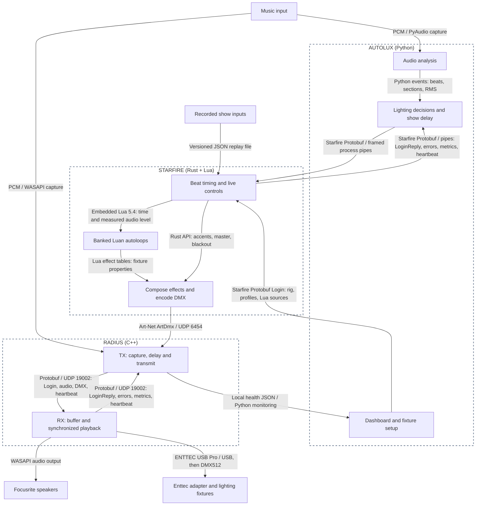

# Starfire design

Autolux decides **what** the music calls for. Starfire renders the light.
Radius delivers light and delayed audio together. The root CLI owns startup,
readiness, remote deployment and shutdown; the existing dashboard is the operator interface.

## Components and protocols

Dotted rectangles show application boundaries. Arrows name protocols or in-process APIs.

- **Music input:** the same feed is captured independently for analysis and room playback.
- **Audio analysis:** detects beats, tempo and nine section classes; measures smoothed RMS loudness.
- **Lighting decisions and show delay:** commits sections, selects an autoloop ID, requests transitions
  and accents, and delays commands to match TX audio.
- **Dashboard and fixture setup:** monitors the show and owns addresses, profiles, calibration
  and named groups. Autolux supplies these and its Lua sources at login. Browser access
  uses HTTP on port 8765.
- **Beat timing and live controls:** receives typed commands, interpolates musical position
  between beats and supplies explicit time to the renderer.
- **Banked Luan autoloops:** describe baseline colour, brightness and movement using groups.
  Atmospheric, Breakdown, Buildup and Drop are the first banks.
- **Compose effects and encode DMX:** combines baseline, overrides, master and blackout;
  maps fixture properties to complete universe frames.
- **TX: capture, delay and transmit:** holds audio, receives DMX and stamps outgoing media
  with the Radius session and audio-frame position.
- **RX: buffer and synchronized playback:** absorbs jitter and schedules DMX against audible
  audio. Audio and USB output use separate threads.
- **Recorded show inputs:** timed commands replay through the same engine for deterministic
  tests. Converted analysis reports omit unrecorded controls.
- **Focusrite speakers:** play the receiver's buffered audio.
- **Enttec adapter and lighting fixtures:** convert USB output into physical DMX.

The CLI launches local processes and deploys/starts RX using **SCP over SSH**.
[Starfire's contract](../proto/starfire/starfire.proto) uses a one-byte message type
and four-byte big-endian payload length before each standalone Protobuf message
on owned stdin/stdout pipes.
Login carries the complete rig, required profiles, Lua sources and initial settings;
LoginReply confirms readiness. Asset edits apply on a new session.
The four control families are PlayAutoloop, active effects, UpdateBeat and
SetParameter. Rejections use ErrorReply; Metrics reports command progress.
See the [protocol](starfire/protocol-design.md).
[Radius's contract](../proto/radius/radius.proto) uses the same framing inside
1,200-byte UDP datagrams. TX waits for LoginReply before capturing media. Both
Login protocols require equal major versions and negotiate the lower minor.
Both links exchange 10-second heartbeats and time out after 30 seconds.

## What "clock" means

- **Musical position:** where we are in the music. Beat messages provide position and BPM.
  At 120 BPM, position advances two beats per second; halfway between beats 10 and 11
  it is 10.5. New anchors correct the estimate. Starfire never receives audio.
- **Animation position:** how far an autoloop has moved. It advances with tempo and requested
  animation speed without jumping when speed changes. Beat pulses use musical position;
  movement can use animation position.
- **Elapsed musical beats:** accumulated beats at the current tempo, without phase jumps.
  Crossfades use this so a corrected beat estimate cannot change their duration.
- **Render cadence:** when another frame is computed. **40 Hz means every 25 ms**:
  20 updates per beat at 120 BPM, 10 at 240 BPM. BPM does not set the frame rate.
- **Monotonic elapsed time:** paces the live host, expires timed accents and timeouts. It only moves forward,
  independently of calendar time. The engine receives explicit seconds, so replay is
  independent of computer speed and wall time.
- **Audio-frame position:** Radius's media clock counts stereo sample frames since session
  start. At 44.1 kHz, 44,100 frames represent one second. Its 64-bit watermark identifies
  audio/DMX alignment; it adds no delay itself.

The **14-second show delay** gives analysis time to decide. It is applied once
to TX audio and once to the matching control stream. The receiver's approximately
**150 ms jitter buffer** is additional and shared by audio/DMX scheduling.
An event at source second 10 reaches the transport around second 24, then plays
after receiver/device buffering.

Art-Net carries DMX values, not Radius watermarks. TX stamps the latest frame when
it samples DMX; render/output cadence adds uncertainty. Physical fixture response
is not sample-exact. Preserving an explicit future target needs a further Radius
handoff change, tracked in the [decision log](starfire/decisions.md).

## Show behavior

- Selecting the active autoloop ID continues its loop. Banks group the supplied scripts.
  A different selection changes the look;
  transitions are cuts or crossfades measured in beats.
- Accents and persistent overrides affect only their targeted properties. Clearing them
  reveals the continuing baseline. Master brightness and blackout act last.
- **Measured audio level** maps smoothed RMS from -48..-12 dBFS to 0..1. It is distinct from user
  brightness and musical section. Lua can use it for modest modulation; faster BPM alone
  does not mean higher intensity. Updates follow detected beats; beatless passages hold
  the last value.
- Every Luan autoloop has a replay test: identical inputs, rig, code and cadence produce
  identical DMX. Scripts cannot read wall time, files, network or randomness.
- Queues and script work are bounded. Faults darken fixtures while preserving movement
  positions; there is no automatic autoloop retry.

## Performance

Each 40 Hz frame has a 25 ms budget. Replay reports `render_realtime_factor`:
show duration divided by rendering time, including commands, Lua and fixture encoding.
The test suite requires at least 10x real-time speed for the 14-fixture room and
2x for a 64-fixture patch, using a 90-second show with transitions and accents.
These measure rendering headroom, not hardware latency or a worst-case deadline.

Control/status pipes run separately with bounded queues. Art-Net sends are
nonblocking; overdue render ticks are skipped. There is no queue of completed
frames or triple buffering. If output needs another worker, prefer a latest-frame
handoff so old frames cannot accumulate latency. Radius's playback buffer remains separate.

See [authoring and commands](../starfire/README.md),
[decisions](starfire/decisions.md) and [validation evidence](starfire/validation.md).
