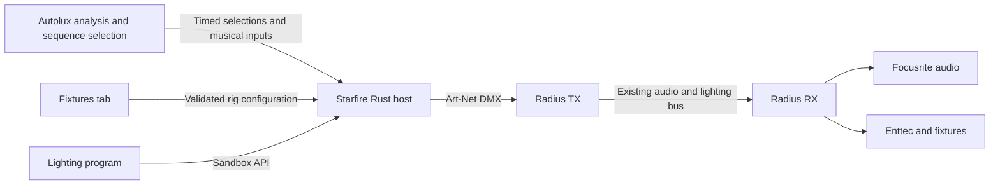

# Starfire design

Status: discussion draft. Requirements below are agreed; architecture and API
proposals need review before implementation. No Starfire runtime exists yet.

## Product

Starfire is a programmable Rust lighting renderer. Autolux supplies musical
evidence, commits sections and selects named sequences. Starfire executes those
sequences; their Lua programs turn timed inputs into fixture properties.
Programs are authored as code in the repository. The existing desktop webapp gets
a Fixtures tab for a simple setup experience. The root Autolux CLI coordinates
the whole product.

Agreed constraints:

- Keep Art-Net DMX output and the existing Radius network path initially.
- Implement the engine in Rust and author lighting programs in embedded Lua.
- Autolux selects named sequences and their effective start positions. Starfire
  executes those selections; Lua does not independently select the next sequence.
- Autolux selects transition policies. Starfire executes the requested timing
  and visual transition without adding its own musical scheduling policy.
- One named Lua sequence corresponds to one SoundSwitch autoloop. Sequences can
  share reusable effect code; Autolux communicates the sequence identity.
- Sequences are grouped into banks. Selecting the active sequence leaves it
  running; there is no restart command. It repeats until a different sequence
  is selected.
- Each bank represents a lighting category with interchangeable alternatives.
  Start with Atmospheric, Breakdown, Buildup and Drop banks. Bank identities are
  configuration, not hardcoded renderer or protocol categories.
- A Lua failure permits Starfire to select another sequence in the same bank.
  This is an explicit fault-handling exception to Autolux's normal selection
  ownership. Report the actual selection and failure to Autolux and the webapp.
- Starfire receives timing and lighting-control data, matching the current
  SoundSwitch integration's useful inputs. It does not receive or analyse audio.
- Keep analysis, rendering, transport and hardware output separate.
- Replace SoundSwitch-specific MIDI/OS2L control with a musical input contract.
- Starfire owns the final lighting state. Retire the external overlay protocol
  and Radius's channel-range mixer when Starfire takes over those effects.
- Hold a section's sustained look until the section changes. Entry accents have
  their own lifetime and do not repeat when a pattern wraps.
- Buildup does not contain a fixed-duration ramp that resets during a longer
  musical buildup. Faster tempo is not evidence of higher musical energy.
- A long Drop must remain comfortable: a brief arrival accent followed by a
  sustainable look, with explicit brightness, movement and strobe limits.
- Design first. No new renderer, protocol implementation or UI scaffolding yet.

## Ownership and deployment

| Component | Owns |
| --- | --- |
| Autolux | Audio analysis, beat evidence, committed nine-class sections, named sequence selection, transition policies, timed show inputs |
| Starfire | Show programs, musical timing interpretation, fixture properties, DMX frames for supplied audio positions |
| Radius | Capture/playback timeline, audio transport, existing watermarks, synchronized receiver scheduling, hardware I/O |
| Existing webapp | Fixture setup, preview and existing system monitoring |
| Root CLI | Configuration, process lifecycle and deployment |

Proposed first deployment: a separate Starfire process on the controller PC.
This preserves the receiver deployment and isolates program failures from audio.
Running it inside Radius would introduce Rust/C++ integration; running it on the
receiver would move program deployment and musical scheduling across the network.
Neither change is necessary to establish the renderer.

Art-Net destination/interface selection must be explicit. The current route is
local Art-Net into Radius; broadcasting to additional lighting receivers must
not accidentally create a second, differently delayed output path.

## Musical input contract

Programs receive one immutable snapshot for the instant being rendered, plus
discrete events. Input age, validity and source time travel with the values.

| Input | Required semantics |
| --- | --- |
| Session and transport | Session identity, playing/silent state, discontinuities and reset behavior |
| Timeline | Source audio position, sample rate, render target and configured show delay |
| Rhythm | Beat anchors, continuous beat phase, downbeat/bar information where known, tempo and validity |
| Sequence selection | Bank and named sequence, command identity, effective audio position, parameters and transition policy |
| Rig | Fixture/group identities, supported properties, geometry and calibration |
| Show controls | Program parameters, master level, operator overrides and deterministic random seed |

Autolux owns the mapping from its nine section classes to named lighting
sequences, including the initial Atmospheric, Breakdown, Buildup and Drop groups.
The renderer contract does not need those classes or hardcoded sequence names.
Lua controls the selected sequence's appearance and beat-driven evolution; it
does not run a competing section-to-sequence selector.
Do not fabricate future section ends or a buildup-completion percentage. Live
analysis cannot generally know how much longer a section will last.

The current SoundSwitch adapter sends OS2L beat number, tempo/change information,
play/stop state, and periodic beat/time position updates; MIDI selects loops,
levels and accents. OS2L's beat strength is currently a constant, not measured
energy. Its emulated DJ-deck metadata is adapter-specific. Preserve the useful
timing/control semantics rather than reproducing those compatibility messages.

Starfire's first input contract excludes PCM, energy bands, RMS and instrument
detection. The current analyser's `on_note` is derived from beats, not a separate
instrument detector. Continuous beat phase comes from the supplied timing; the
renderer does not rediscover beats by listening to audio. Keep musical phase and
an audio-frame output watermark distinct: phase drives animation, while the
watermark tells Radius which audible audio position a frame belongs to.

Candidate input transports:

| Option | Benefit | Cost |
| --- | --- | --- |
| Typed Protobuf messages over local TCP | Fits the existing IDL approach; explicit structured data and versioning | Requires a small framing/reconnection contract |
| OSC | Familiar musical control interface | Still needs defined schemas, event identity and clock semantics |
| In-process Rust binding | Fewer process messages | Couples Python and renderer lifecycle and packaging |

Prefer evaluating local Protobuf/TCP first. This is a proposal, not a selected
protocol. Any IDL belongs under root `proto/`. Reconnecting must deliver a current
snapshot and upcoming events without replaying expired section-entry accents.

## Time and synchronization

This contract must be settled before effect APIs or networking code.

1. Use an explicit audio timeline and session identity. Distinguish source audio
   position, the instant a decision becomes available, and room playback time.
2. Apply the show delay exactly once. RX jitter/device buffering is separate and
   remains shared by audio and lighting through Radius scheduling.
3. Timestamp beat anchors, sequence selections and controls. A render snapshot
   must describe the same musical instant across those inputs.
4. Distinguish a sequence activation from duplicate selection messages. Autolux
   resolves repeated section decisions; transport retries and reconnects must
   not accidentally retrigger sequence-entry effects.
5. Correct beat phase without restarting every oscillator. Define behavior for
   tempo changes, missing beats, half/double tempo and loss of confidence.
6. Late selection commands must not produce a burst of expired effects. Define
   an explicit late-command policy and report lateness to Autolux. Do not invent
   a second hidden section debounce or musical transition policy in Starfire.

Autolux may request a cut, beat/bar-aligned activation or timed crossfade. Resolve
quantized requests to a common musical/audio position; Starfire must not add a
second quantization delay. Crossfades blend semantic properties, with explicit
handling for discrete fixture functions, rather than interpolating DMX bytes.

Current integration facts to account for:

- Radius TX samples incoming Art-Net state every 25 ms and attaches its current
  audio watermark. Art-Net does not carry our 64-bit audio-frame watermark.
- TX's delay buffer shifts PCM content while the outgoing watermark advances.
  With the current implementation, source frame `n` emerges at output position
  `n + delay_frames`. Do not add this offset again after a delayed handoff.
- Python and Radius currently capture audio separately. Their stream origins
  cannot be assumed identical merely because their sample rates match.

Proposed ownership: one audio timeline supplies the session identity and 64-bit
frame positions. Autolux associates its musical evidence with that timeline;
Starfire renders for a target position and attaches the corresponding watermark.
Starfire must not invent a separate counter or derive positions from packet
arrival times. The lighting program never owns clock synchronization.

There are two distinct output integration choices:

- Preserve the current Art-Net ingress: Starfire emits at the appropriate
  delayed instant and Radius stamps its current watermark. This is compatible
  with the existing route but loses the renderer's exact target position.
  Measure render pacing and TX sampling error; do not call it sample-exact.
- Preserve the target position through a local, timestamped DMX handoff to
  Radius. The existing TX/RX envelope already represents a lighting target.
  This needs a new local ingress and a deliberate Art-Net output boundary;
  do not silently remove the agreed Art-Net output or add a second live path.

The second option is preferable for precise scheduling, but its placement and
the conversion from source positions to delayed output positions remain open.
Neither option implies sample-resolution physical light output: render cadence,
USB/DMX transmission and fixture response still constrain visible timing.

Compare two clock-input designs before committing:

- Explicitly anchor the existing analysis clock to the TX session and monitor
  drift. This is the smaller integration but needs measurable error bounds.
- Give Autolux a timestamped analysis tap from Radius's capture stream. This
  provides shared sample identity and one capture owner, but changes local audio
  plumbing. It need not change the receiver network protocol.

## Programmable sandbox

Proposed boundary: a program receives musical/rig inputs and returns desired
fixture properties. The host owns time, networking, patching and hardware access.
Writing a program must not require knowing fixture DMX addresses.

Decision: Rust owns the engine and named Lua sequences author the lighting.
Fast iteration on the same music is the reason for reloadable scripts. Begin
with one Lua runtime and a narrow host API; no Wasm or native plugin system.

Keep the Lua boundary narrow: one active sequence, one render callback per target
instant, an immutable musical snapshot, and bounded semantic lighting output.
Rust supplies beat/section time, reusable curves and movement helpers, validates
results, converts fixture properties to DMX, and schedules output. Scripts do
not sleep, run their own event loops or create network/device connections.
Repeated render calls evaluate the current musical position; they do not advance
an independent animation clock. Prefer explicit small state for section-entry
accents over coroutine scheduling in the first version.

Lua adds a second language, dynamic errors, a binding API and garbage collection.
The Rust binding `mlua` offers memory limits and instruction hooks, but those
are not hard real-time guarantees and do not bound blocking native calls. Use
an explicit library allowlist, bounded host functions and validation of finite
property values. Default "safe" libraries alone are not an application sandbox.
Run scripts away from audio callbacks and measure the render budget on our rig.
The Lua implementation/version and Rust binding remain to be selected; `mlua`
is the initial binding candidate. No runtime dependency has been added.

The sandbox proposal needs:

- A versioned API, bounded input/output sizes, and explicit optional capabilities.
- Supplied clocks and seeded randomness; no ambient wall clock or uncontrolled
  randomness in effects that must replay deterministically.
- CPU, memory, stack and output limits. Host calls must also be bounded and
  nonblocking; VM execution limits cannot rescue a blocking host function.
- No filesystem, network or device access in the render callback. Compilation
  and module loading happen away from rendering.
- Defined program state, reset/seek semantics and replay from a known checkpoint.
- Transactional reload: validate a replacement, preserve the last working
  program on failure, and activate at an explicit musical boundary. Reloading
  does not masquerade as entering the current section again.

Each sequence is a Lua program, conceptually a file such as `drop.lua`, selected
by a stable registered name rather than a caller-supplied filesystem path.
Each belongs to a bank and keeps running until replaced by a different sequence.
Selecting it again does not restart it or replay entry effects. Pattern
repetition also does not re-enter it. Shared Lua modules and Rust helpers avoid
copying common effects. Banks group musically compatible alternatives. Fallback
order and the behavior when no usable sequence remains are open decisions.

Proposed API: Lua writes semantic fixture properties and can calculate arbitrary
curves or choreography. Rust supplies groups, musical time, optional effect
helpers, validation and profile encoding. A helper catalogue must not limit what
can be authored: a script can use a circle helper or calculate its own movement
path. Normal sequences do not write raw DMX channel addresses. The exact callback
and state API, and the supported transition-policy parameters, remain discussion
topics. Autolux owns selection of those policies.

## Lighting model

Reusable primitives should express beats, bars, curves, palettes, fixture groups,
symmetry and movement paths. Programs compose these into section behavior:

- **Entry:** bounded one-shot accent.
- **Sustain:** continuous beat-driven pattern for an unknown section duration.
- **Exit:** transition to the next look without abrupt movement or stale strobes.

Resolve intensity, colour, position and shutter as properties before encoding
DMX. Define conflict rules per property. Taking the maximum byte from multiple
effects is not valid for colour wheels, pan/tilt pairs or multifunction channels.
Master level and blackout apply at the final property stage and always win.

Fixture encoding handles coarse/fine channels, virtual dimmers, RGB/UV versus
colour wheels, calibrated movement ranges, shutters and fixture-specific mode
values. Unsupported functions have explicit fallback behavior. Unclaimed
properties return to a defined baseline rather than retaining arbitrary bytes.

Normal show programs must never emit fixture reset/service commands through an
accidental channel range. Blackout should suppress light while preserving a
defined movement state; zeroing every byte is not a universal fixture policy.

## Fixtures tab

Keep setup focused:

- Select fixture profile and channel mode; assign universe and address.
- Name fixtures and groups, order them spatially, and detect patch overlap.
- Set orientation, movement limits, inversion and calibration targets.
- Identify a fixture and test intensity/colour/movement with an explicit
  temporary override that releases cleanly.
- Validate and save a rig revision; activate patch changes deliberately rather
  than silently moving addresses in a running show.

Separate a reusable device profile from an installed fixture's address and
calibration. Evaluate Open Fixture Library and existing QLC+ profiles as import
sources. Imported profiles still need mode/capability validation on our fixtures.
Do not build a fixture editor, visual timeline editor or new frontend unless a
demonstrated setup need requires it.

## Runtime, failures and visibility

Begin by evaluating a 40 Hz renderer to match the current transport cadence.
Derive animation from musical time, not the number of frames executed. Missing a
deadline skips obsolete frames instead of playing them rapidly to catch up.

Separate render work from control/configuration, compilation and network I/O with
bounded queues. Prefer a small runtime over an ECS or general job scheduler.
Define how queued state updates coalesce and which events must be preserved.

A stalled program must not leave a strobe latched. Accent expiry and master
blackout must remain host-controlled. On a Lua fault, try another sequence from
the same bank. Proposed safeguards: exclude the failed revision until replaced,
bound fallback attempts, and suppress entry accents during fault recovery. The
all-sequences-failed behavior remains to be agreed. Define bounded hold/fade
behavior for lost timing, process exit and output loss separately. Keep the
existing 10-second bidirectional Radius heartbeats and receiver failure policy.

Use the existing dashboard and Prometheus path. Useful renderer measurements are
render time, missed deadlines, input/clock age, late section events, output age
and program faults. Show the active program/revision and section as context.
Add queue metrics only where they help explain one of these failures.

## Design validation before implementation

Review the design against concrete cases:

1. The same recorded input and program produce the same output on replay.
2. A 60-second buildup continues without periodic intensity resets.
3. A 60-second drop accents once, then sustains; duplicate inputs/reload do not
   restart its accent, and a program fault cannot prolong its strobe.
4. Tempo changes, missing beats and late sections have defined visible behavior.
5. Colour and movement intent map correctly to our actual Home rig.
6. Receiver jitter, startup, pause and reconnection preserve audio alignment.
7. A failing replacement program leaves the current show usable.
8. Fixture setup and monitoring fit the existing webapp and single CLI lifecycle.

Use the local James Hype / Agents Of Time track for short reviews. Its first two
minutes include the four lighting categories in the hand labels. Keep two test
modes explicit: annotated sections for judging rendering, and live predictions
for judging the end-to-end system. An annotation-driven show is not evidence of
classifier accuracy.

Open decisions: Lua binding and sandbox API, clock source, input framing, sequence
composition/state, profile import subset, transition semantics and failure
deadlines. Resolve these with examples and measurable budgets before creating
the Rust package or changing the network path.

## References

- [Afterglow effects](https://deepsymmetry.org/afterglow/guide/afterglow/effects.html)
  and [dynamic parameters](https://deepsymmetry.org/afterglow/guide/afterglow/parameters.html):
  useful examples of metronome-driven and fixture-aware composition.
- [Art-Net](https://art-net.org.uk/): retained DMX network interface.
- [SoundSwitch autoloops](https://support.soundswitch.com/en/support/solutions/articles/69000847100-soundswitch-autoloops-explained)
  and [OS2L](https://os2l.org/): externally synchronized repeating lighting
  sequences and the existing timing/control contract.
- [OLA overview](https://www.openlighting.org/ola/) and
  [installation support](https://www.openlighting.org/ola/getting-started/downloads/):
  optional routing/device backend, not a requirement for Starfire. Its Windows
  support must be verified before considering it for this deployment.
- [Lua language and runtime](https://www.lua.org/manual/5.4/manual.html) and
  [mlua host API](https://docs.rs/mlua/latest/mlua/struct.Lua.html): embedding,
  library selection, instruction hooks and memory limits.
- [Open Fixture Library model](https://github.com/OpenLightingProject/open-fixture-library/blob/master/docs/fixture-model.md):
  fixture import complexity, including fine and switching channels.
